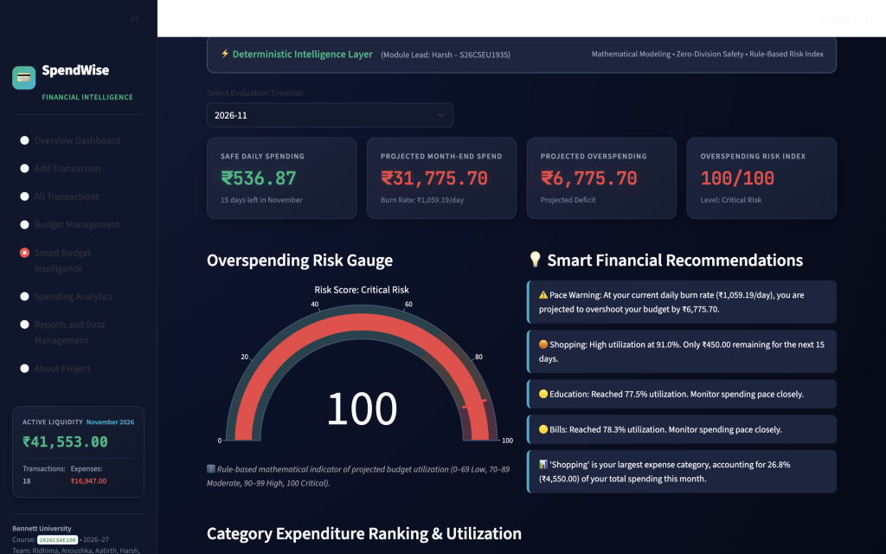

# SpendWise – Personal Expense and Budget Tracker

[](https://www.python.org/)
[](https://streamlit.io/)
[](https://plotly.com/)
[]()

> **Bennett University**  
> **School of Computer Science Engineering and Technology**  
> **Course:** Computational Thinking and Programming (`2026CSAE100`)  
> **Academic Year:** 2026–2027  

---

## 📌 Project Overview

**SpendWise** is a lightweight, self-hosted personal finance management dashboard designed for university students to track daily pocket money, stipends, and category-wise spending. Built using pure Python, Streamlit, and Plotly, SpendWise replaces opaque machine learning and paid banking APIs with **transparent computational thinking**, explainable mathematical modeling, and local file persistence (CSV & JSON).

---

## 👥 Project Team & Core Contributions

| Team Member | Enrollment / ID | Assigned Contribution & Core Module |
| :--- | :---: | :--- |
| **Ridhima** | `S26CSEU1925` | **Project Coordination & Expense-Tracking Workflow** (`views/view_add_transaction.py`) |
| **Anoushka** | `S26CSEU1922` | **Project Documentation & Organization of Report Content** (`docs/`, `modules/data_manager.py`) |
| **AATIRTH** | `S26CSEU1913` | **Transaction Data Handling & Calculation Logic** (`modules/calc_engine.py`) |
| **HARSH** | `S26CSEU1935` | **Budget Monitoring & Alert Logic (Special Computational Focus)** (`modules/budget_engine.py`, `modules/intelligence_engine.py`) |
| **SRISHTHI** | `S26CSEU1939` | **Spending Analysis & Visualization / Reporting** (`views/view_analytics.py`, `views/view_overview.py`) |

---

## 🛡️ Special Computational Feature (Harsh's Focus)

The primary computational engine of SpendWise is the **Smart Budget Intelligence Engine** implemented by **Harsh (`S26CSEU1935`)** across `modules/budget_engine.py` and `modules/intelligence_engine.py`:

1. **4-Tier Deterministic Alert System**:
   - **Normal (< 70%):** Spending velocity is healthy; surplus expected.
   - **Spending Awareness (70% – 89%):** Discretionary expenditure pacing recommended.
   - **High Spending Warning (90% – 99%):** Critical limit approaching; non-essential spending paused.
   - **Budget Exceeded (≥ 100%):** Budget breached; deficit alerts active; daily safe limit locked to ₹0.
2. **Daily Safe-to-Spend Limit**:
   $$L_{\text{safe}} = \frac{\max(0, \text{Monthly Budget} - \text{Incurred Expenses})}{\text{Total Days in Month} - \text{Current Day} + 1}$$
3. **Linear Run-Rate Expense Forecast**:
   $$E_{\text{forecast}} = \left( \frac{\text{Month-to-Date Expenses}}{\text{Days Elapsed}} \right) \times \text{Total Days in Month}$$
4. **Overspending Risk Index (0–100 Score)**:
   A rule-based computational gauge measuring projected budget exhaustion. (Not a statistical probability of financial loss).

---

## 💻 Tech Stack & Architecture

- **Programming Language:** Python 3.9+ (Built-in standard libraries: `datetime`, `calendar`, `os`, `shutil`, `csv`, `json`, `uuid`, `unittest`)
- **Web UI & Dashboard:** Streamlit 1.50+
- **Interactive Visualizations:** Plotly Express & Plotly Graph Objects 7.1+
- **Data Persistence:**
  - `data/transactions.csv` (Flat-file CSV ledger)
  - `data/budget.json` (Structured JSON budget configuration)
  - `data/backups/` (Automated timestamped snapshots)

```text
SpendWise_Project/
├── app.py                      # Main Streamlit dashboard router
├── config.py                   # Central constants, categories & 70/90/100% thresholds
├── requirements.txt            # Python dependencies
├── data/                       # CSV ledger & JSON budget storage
├── modules/
│   ├── budget_engine.py        # [Harsh] Budget monitoring & 4-tier alert logic
│   ├── intelligence_engine.py  # [Harsh] Daily safe limits, run-rate forecast & risk index
│   ├── calc_engine.py          # Arithmetic engine & INR (₹) formatter
│   ├── data_manager.py         # File I/O for CSV & JSON with backup snapshots
│   ├── sample_data.py          # Isolated demo seeder (INR ₹)
│   └── styles.py               # Deep dark navy & emerald green SaaS CSS
├── views/                      # 8 Modular UI views
├── tests/                      # Automated unit test suite (44 passing tests)
└── docs/                       # Complete Bennett University project documentation
```

---

## 🚀 Quick Start Guide

### 1. Clone or Open Workspace
```bash
cd SpendWise_Project
```

### 2. Set Up Virtual Environment & Dependencies
```bash
python3 -m venv .venv
source .venv/bin/activate
pip install -r requirements.txt
```

### 3. Run Automated Unit Tests
```bash
python3 -m unittest discover tests -v
```
*(Expected output: 44 tests ran in 0.007s, OK)*

### 4. Launch the Dashboard
```bash
streamlit run app.py
```
Open your browser at `http://localhost:8501`.

---

## 📸 Dashboard Preview



---

## 📚 Complete Project Documentation

Detailed university reports and guides are available in the [`docs/`](file:///Users/harshraj/Desktop/SpendWise_Project/docs/) folder:
- [Project Overview & Report](file:///Users/harshraj/Desktop/SpendWise_Project/docs/project_overview.md)
- [Python Concepts Guide](file:///Users/harshraj/Desktop/SpendWise_Project/docs/python_concepts.md)
- [Algorithms & Flowcharts](file:///Users/harshraj/Desktop/SpendWise_Project/docs/algorithm_and_flowchart.md)
- [Budget Intelligence Explanation](file:///Users/harshraj/Desktop/SpendWise_Project/docs/budget_intelligence_explanation.md)
- [Comprehensive Testing Report](file:///Users/harshraj/Desktop/SpendWise_Project/docs/testing_report.md)
- [Team Contributions Breakdown](file:///Users/harshraj/Desktop/SpendWise_Project/docs/team_contributions.md)
- [Hinglish Viva Voce Guide (45+ Q&A)](file:///Users/harshraj/Desktop/SpendWise_Project/docs/viva_questions_answers.md)
- [Installation & Setup Guide](file:///Users/harshraj/Desktop/SpendWise_Project/docs/installation_guide.md)
