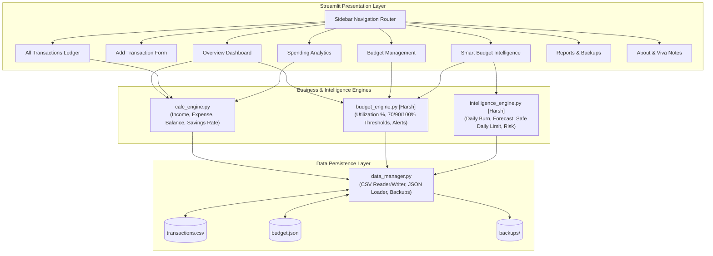
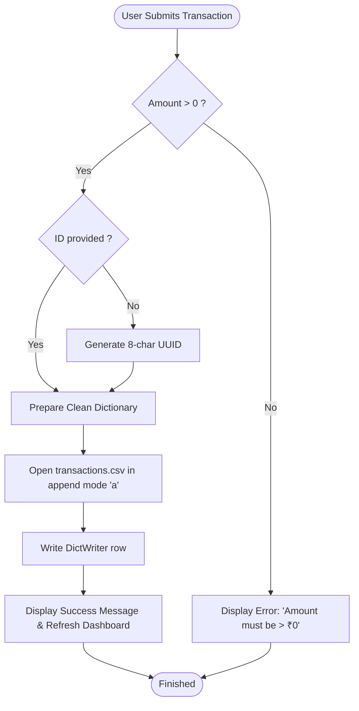
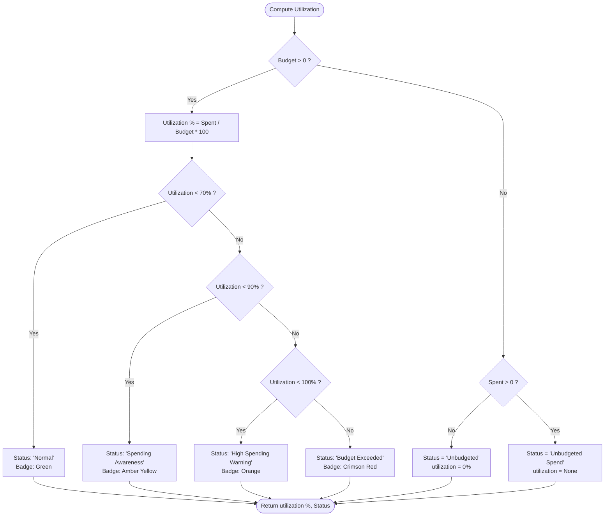
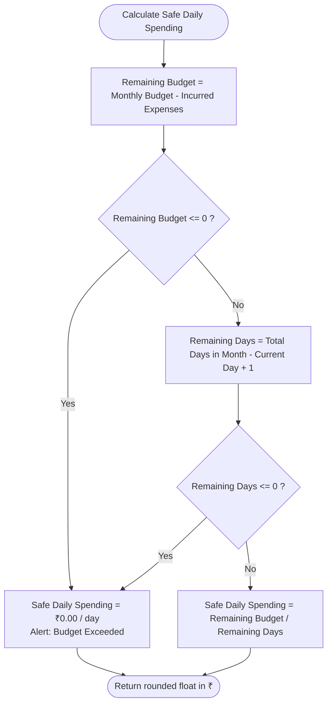

# SpendWise – Algorithms & Flowchart Specification
## Computational Logic & Decision Tree Documentation

**Course:** Computational Thinking and Programming (`2026CSAE100`)  
**Institution:** Bennett University  
**Academic Year:** 2026–2027  

---

## 1. System Architecture Diagram



---

## 2. Transaction Ingestion & Validation Algorithm



### Pseudocode:
```text
Algorithm AddTransaction(transaction_data):
    Input: dictionary containing date, type, category, amount, payment_mode, description
    Output: boolean success flag

    If float(transaction_data.amount) <= 0:
        Return False (Invalid Amount)

    If transaction_data does not contain "id":
        transaction_data.id = GenerateUUID(8)

    Open "data/transactions.csv" with mode="append":
        writer = csv.DictWriter(file, fieldnames=HEADERS)
        writer.writerow(transaction_data)

    Return True
```

---

## 3. Budget Threshold Evaluation Algorithm (Harsh's Focus)

Evaluates actual spending against planned category or monthly limits using exact 70%, 90%, and 100% thresholds.



---

## 4. Safe Daily Spending Algorithm

Calculates allowable daily burn rate to avoid overspending:



---

## 5. Overspending Risk Index Algorithm

Produces an explainable, deterministic risk index from 0 to 100 based on month-end linear extrapolation:

```mermaid
flowchart TD
    StartRisk([Calculate Risk Index]) --> BurnRate[Daily Burn Rate = Month-to-date Expenses / Elapsed Days]
    BurnRate --> Forecast[Projected Month-End Spend = Burn Rate * Total Days in Month]
    Forecast --> CheckBud{Monthly Budget > 0 ?}
    CheckBud -- No --> CheckProj{Projected Spend > 0 ?}
    CheckProj -- Yes --> Score100[Score = 100, Critical Risk (Unbudgeted)]
    CheckProj -- No --> Score0[Score = 0, Low Risk]
    
    CheckBud -- Yes --> ComputeRatio[Raw Ratio = Projected Spend / Monthly Budget * 100]
    ComputeRatio --> Clamp[Score = min(100, max(0, round(Raw Ratio)))]
    Clamp --> CheckTier{Score < 70 ?}
    CheckTier -- Yes --> LowRisk[Level = 'Low Risk']
    CheckTier -- No --> CheckTier2{Score < 90 ?}
    CheckTier2 -- Yes --> ModRisk[Level = 'Moderate Risk']
    CheckTier2 -- No --> CheckTier3{Score < 100 ?}
    CheckTier3 -- Yes --> HighRisk[Level = 'High Risk']
    CheckTier3 -- No --> CritRisk[Level = 'Critical Risk']
    
    LowRisk & ModRisk & HighRisk & CritRisk & Score100 & Score0 --> ReturnRisk([Return Score, Level, Description, Color])
```
