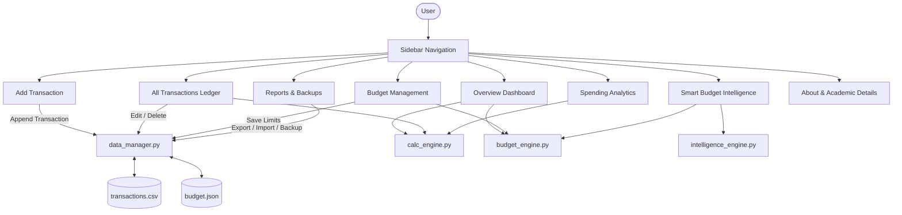

# SpendWise – Personal Expense and Budget Tracker
## Comprehensive Project Report & Academic Overview

**Institution:** Bennett University  
**School:** School of Computer Science Engineering and Technology  
**Course:** Computational Thinking and Programming  
**Course Code:** `2026CSAE100`  
**Academic Year:** 2026–2027  

---

## 1. Problem Statement

University students frequently face difficulties managing their monthly allowances, stipends, and discretionary spending. Common challenges include:
- Lack of visibility into daily burn rates, leading to premature budget exhaustion before month-end.
- Complex commercial financial apps that require paid subscriptions, intrusive banking integrations, or opaque machine learning models that students cannot understand or trust.
- Inability to quickly compute safe daily spending limits to stay within planned category budgets.

**SpendWise** solves this problem by providing a lightweight, transparent, and completely self-hosted financial dashboard where every calculation is based on deterministic mathematics, local file storage (CSV/JSON), and clear computational thinking.

---

## 2. Project Objectives

1. **Intuitive Ledger Tracking:** Enable students to quickly record income and expenses across official categories (Food, Transport, Shopping, Education, Entertainment, Bills, Others) with payment modes and descriptions.
2. **Deterministic Budgeting:** Enforce category-wise and overall monthly budgets using transparent thresholds (**70% Awareness, 90% Warning, 100% Exceeded**).
3. **Actionable Predictive Intelligence:** Calculate daily safe-to-spend limits, linear end-of-month forecasts, and a rule-based overspending risk index without relying on external APIs or complex machine learning.
4. **Data Ownership & Portability:** Store all records in open, readable CSV and JSON formats with one-click export, external import, and automated backup snapshots.
5. **Academic Rigor:** Structure the codebase using clean modular Python principles (functions, loops, dictionaries, file handling, exception handling, and unit testing) suitable for first-year engineering viva presentation.

---

## 3. Main Features & Modular Architecture

The application is structured into an architectural **Three-Tier System**:

1. **Data Access Layer (`modules/data_manager.py`, `modules/sample_data.py`)**:
   - Flat-file CSV storage (`data/transactions.csv`) with automatic header creation.
   - JSON budget configuration (`data/budget.json`) for monthly category limits.
   - Isolated demo dataset seeder formatted in Indian Rupees (₹) loaded strictly on user demand.
   - Timestamped backup snapshots (`data/backups/`) safeguarding user records.
2. **Business & Intelligence Layer**:
   - `modules/calc_engine.py`: Income, expense, net balance, savings rate, and INR formatting.
   - `modules/budget_engine.py`: Category utilization, remaining allowance, alert triggers, and ranking.
   - `modules/intelligence_engine.py`: Calendar context, average daily spending, linear run-rate forecast, safe daily spending limit, and overspending risk index.
3. **Presentation Layer (`app.py`, `views/`, `modules/styles.py`)**:
   - Streamlit multi-view navigation across 8 pages with custom dark navy (`#0B132B`, `#1C2541`) and emerald green (`#10B981`) styling.
   - Interactive Plotly visualizations (cash flow bars, category share donuts, risk gauge, daily spending trajectory).

---

## 4. Program Design & Workflow

---

## 5. Python Concepts Used

- **Variables & Data Types:** Floats for currency, strings for categories and dates, integers for day counts, and booleans for flags.
- **Data Structures:** Lists of dictionaries for transaction records, nested dictionaries for monthly budgets, tuples for return values, and sets for unique month extraction.
- **Control Flow:** Multi-branch conditional statements (`if-elif-else`) for budget tier mapping.
- **Functions & Modules:** Modular function definitions with type hints, default arguments, and docstrings.
- **File Handling & Serialization:** Context-managed file reading and writing using `csv.DictReader`, `csv.DictWriter`, and `json.dump` / `json.load`.
- **Defensive Exception Handling:** `try-except` blocks preventing `ZeroDivisionError`, `ValueError`, and `FileNotFoundError`.
- **Standard Libraries:** `datetime`, `calendar` (leap year calculation), `os`, `shutil`, `uuid`, `unittest`.

---

## 6. Computational Feature (Harsh's Focus)

The core computational contribution of the project is the **Budget Monitoring and Alert Logic** led by **Harsh (`S26CSEU1935`)**:

- **Budget Utilization Formula:**
  $$U_c = \left( \frac{\text{Spent}_c}{\text{Budget}_c} \right) \times 100\%$$
- **Alert Tiers:**
  - $U_c < 70\%$: **Normal** (Safe green)
  - $70\% \le U_c < 90\%$: **Spending Awareness** (Amber yellow)
  - $90\% \le U_c < 100\%$: **High Spending Warning** (Orange)
  - $U_c \ge 100\%$: **Budget Exceeded** (Crimson red)
- **Safe Daily Spending Limit:**
  $$L_{\text{safe}} = \frac{\max(0, \text{Budget} - \text{Expenses})}{\text{Total Days} - \text{Current Day} + 1}$$
- **Linear Run-Rate Forecast:**
  $$E_{\text{forecast}} = \left( \frac{\text{Expenses}}{\text{Elapsed Days}} \right) \times \text{Total Days}$$
- **Overspending Risk Index (0–100):**
  $$\text{Risk Score} = \min\left(100, \max\left(0, \text{round}\left( \frac{E_{\text{forecast}}}{\text{Budget}} \times 100 \right)\right)\right)$$

---

## 7. Important Outputs & Screenshots

The application provides 8 responsive screens:
1. **Overview Dashboard:** High-level financial KPIs, budget progress bar, cash flow bars, and donut breakdown.
2. **Add Transaction:** Dual-tab input form with field validations.
3. **All Transactions:** Interactive searchable ledger with row edit and delete options.
4. **Budget Management:** Category-wise progress meters and threshold indicators.
5. **Smart Budget Intelligence:** Plotly risk gauge, safe daily limits, and smart recommendations.
6. **Spending Analytics:** Multi-month comparisons and daily cumulative spending trajectories.
7. **Reports & Data Management:** CSV export, JSON backup snapshots, demo seeder, and safe database wipe.
8. **About Project:** Institutional metadata and team contribution profile cards.

---

## 8. Testing Summary

- Comprehensive test suite implemented in `tests/` using Python's built-in `unittest` framework.
- **44 automated test cases executed**:
  - `test_calculations.py`: 14 tests (Income, expense, net balance, savings rate, INR format, edge cases).
  - `test_data_manager.py`: 10 tests (File creation, CRUD, updates, backups, invalid inputs).
  - `test_budget_engine.py`: 10 tests (Threshold boundaries at 69.9%, 70.0%, 90.0%, 100.0%, unbudgeted spend).
  - `test_intelligence_engine.py`: 10 tests (Leap year February, run-rate forecast, risk index clamp, safe daily spend).
- **Result:** 44 tests passed, 0 failures, 0 errors in 0.007s.

---

## 9. Team Member Contributions

- **Ridhima (`S26CSEU1925`):** Project coordination and expense-tracking workflow.
- **Anoushka (`S26CSEU1922`):** Project documentation and organization of report content.
- **AATIRTH (`S26CSEU1913`):** Transaction data handling and calculation logic.
- **HARSH (`S26CSEU1935`):** Budget monitoring and alert logic (Core computational modules: `budget_engine.py` & `intelligence_engine.py`).
- **SRISHTHI (`S26CSEU1939`):** Spending analysis and visualization / reporting.

---

## 10. Challenges Faced & Learnings

1. **Zero-Division Handling:** When income or budgets are ₹0, standard division throws `ZeroDivisionError`. We engineered defensive clauses returning `0.0%` or `"Unbudgeted Spend"` to ensure application stability.
2. **Leap Year and Month Length Variance:** Standard 30-day assumptions produce incorrect forecasts in February (28 vs 29 days). We resolved this by integrating Python's standard `calendar.monthrange(year, month)` dynamically.
3. **Atomic File Persistence:** Preventing CSV corruption during concurrent writes was solved by using context managers (`with open`) and explicit fieldname validation.

---

## 11. Conclusion & Future Improvements

**SpendWise** demonstrates that sophisticated, fintech-grade personal budgeting does not require complex cloud databases or black-box machine learning. By applying fundamental computational thinking principles, the team created a reliable, explainable, and visually impressive application.

**Future Enhancements:**
- Multi-currency support (USD, EUR, GBP) alongside INR.
- Recurring bill reminders and notification webhooks.
- PDF summary report generation with embedded Plotly charts.

---

## 12. References & Acknowledgements

1. Python Software Foundation. *Python 3.10+ Official Documentation* (csv, json, calendar, datetime, unittest).
2. Streamlit Documentation. *Streamlit API Reference & Application Testing Framework*.
3. Plotly Technologies Inc. *Plotly Python Open Source Graphing Library*.
4. Bennett University, School of Computer Science Engineering and Technology, for providing the academic curriculum and project guidelines for *Computational Thinking and Programming (2026CSAE100)*.
